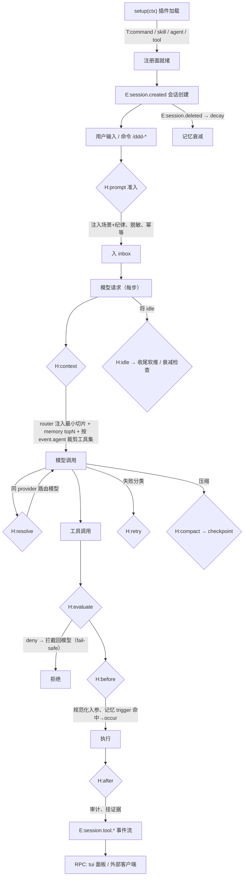
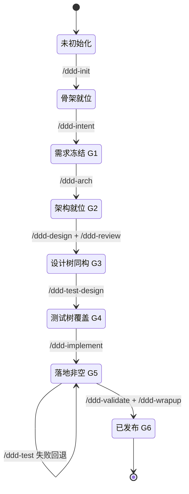
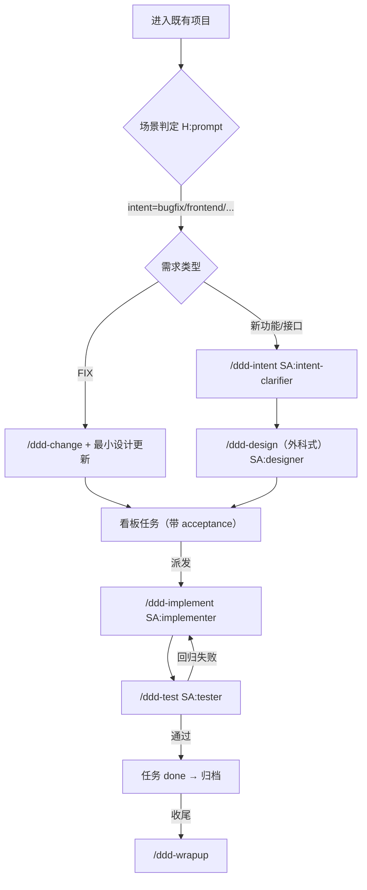
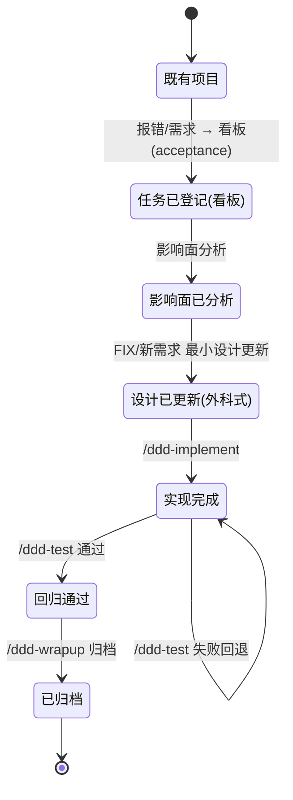
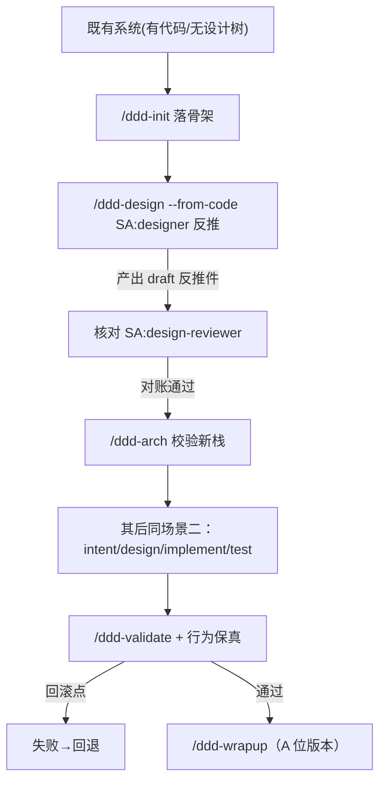
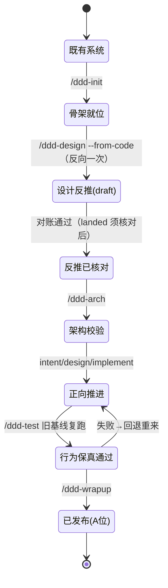

# 全局视图：场景数据流 · 状态 · OpenCode 钩子作用点

> 本件是**解释性视图**（派生物），便于理解；权威以 `docs/OUTLINE-DESIGN.md` 与 `docs/ddd/**` 为准。
> 图用 Mermaid。钩子/事件均取自 OpenCode v2.2.7 实证面。

## 图例

| 记号 | 含义 |
|---|---|
| `setup` | 插件加载时的 `Plugin.define.setup(ctx)` |
| `T:*` | transforms（`ctx.*.transform`，同步可重放） |
| `H:prompt` | `session.hook("prompt")` 准入拦截 |
| `H:context` | `session.hook("context")` 每次模型请求前 |
| `H:resolve` | `session.hook("experimental.model.resolve")` |
| `H:evaluate` | `permission.hook("evaluate")` 审批风控 |
| `H:before` / `H:after` | `tool.hook("execute.before"/"execute.after")` |
| `H:shell` | `shell.hook("create.before")` |
| `H:retry` | `session.hook("retry")` |
| `H:compact` | `session.hook("compaction")` |
| `H:idle` | `session.hook("experimental.idle")` |
| `E:*` | `ctx.event.subscribe` 事件 |
| `SA` | 子代理（`mode: subagent`）派发 |
| `RPC` | `ctx.rpc.register` / tui · 外部客户端 |

---

## 一、全局请求生命周期 ↔ 我方机制

**钩子→机制矩阵**

| 生命周期 | 钩子/事件 | 我方机制 |
|---|---|---|
| 加载 | `setup` + transforms | 注册命令/技能/角色/工具；RPC |
| 准入 | `H:prompt` | 场景声明、纪律注入（幂等）、脱敏 |
| 每步请求 | `H:context` | router 注入切片；memory topN；**按 agent 裁剪工具集**（Q4） |
| 模型选择 | `H:resolve` | 模型治理/路由 |
| 审批 | `H:evaluate` | 底线守卫 fail-safe |
| 工具前/后 | `H:before`/`H:after` | 参数规范化、记忆复发统计、审计证据 |
| shell | `H:shell` | 超时/环境 |
| 失败 | `H:retry` | 退避策略 |
| 压缩 | `H:compact` | 记忆 checkpoint |
| 空闲 | `H:idle` | 收尾软推一次 |
| 会话结束 | `E:session.deleted` | 记忆衰减 |
| 全程 | `E:*` | 审计留痕；RPC 外供 |

---

## 二、场景一 · 项目从零开始选型实现

### 2.1 数据流

```mermaid
flowchart LR
  I["/ddd-init"] -->|"生成 docs/ 骨架 + AGENTS.md"| A["骨架就位"]
  A --> N["/ddd-intent SA:intent-clarifier"]
  N -->|"REQUIREMENTS frozen"| AR["/ddd-arch SA:architect"]
  AR -->|"ARCHITECTURE + 变体契约(前端)"| D["/ddd-design SA:designer"]
  D -->|"设计树 draft"| RV["/ddd-review SA:design-reviewer"]
  RV -->|"评审结论"| TD["/ddd-test-design SA:test-designer"]
  TD --> IM["/ddd-implement SA:implementer"]
  IM --> TS["/ddd-test SA:tester"]
  TS -->|"失败→回实现"| IM
  TS -->|"通过"| VD["/ddd-validate (G1..G6)"]
  VD -->|"全过"| W["/ddd-wrapup + /ddd-consolidate"]
```

**钩子作用点**

| 阶段 | 作用点 |
|---|---|
| 每次输入 | `H:prompt` 注入「场景=零起」声明 + 当前相位 |
| 每次模型请求 | `H:context` 注入该相位切片（如 arch→选型论证据要）；按角色裁剪工具（reviewer/auditor 只读） |
| 角色执行 | `SA` 子会话（`subagent`）；`H:before`/`H:after` 观测与证据 |
| 审批 | `H:evaluate`（危险动作 deny/ask） |
| 收尾 | `H:compact` checkpoint；`/ddd-consolidate` 归并；`E:session.deleted` 衰减 |

### 2.2 状态图（门禁为迁移）

---

## 三、场景二 · 二次开发（Todo 驱动）

### 3.1 数据流

**钩子作用点**

| 阶段 | 作用点 |
|---|---|
| 进入项目 | `H:prompt` 判场景/意图（二次开发），注入对应切片 |
| 每步 | `H:context` 注入看板摘要（待办/进行/阻塞计数 + topN）；按角色裁剪工具 |
| 工具执行 | `H:before` 记忆 `trigger` 命中→`occur`；`H:after` 挂验收证据 |
| 审批 | `H:evaluate` 危险动作 |
| 记忆 | `H:compact` checkpoint；`E:session.deleted` 衰减 |

### 3.2 状态图

---

## 四、场景三 · 项目迁移

### 4.1 数据流

**钩子作用点**

| 阶段 | 作用点 |
|---|---|
| 进入 | `H:prompt` 判「迁移」；注入迁移纪律（**方向反转一次**） |
| 反推 | `H:context` 注入「反推=一次性、须对账」切片；`SA` 反推子代理输入面仅代码 |
| 核对 | `SA:design-reviewer` 只读；`H:after` 挂对账证据 |
| 保真 | `/ddd-validate` 跑旧基线用例；失败即回滚 |
| 收尾 | `/ddd-consolidate` + 版本 A 位；`E:session.deleted` 衰减 |

### 4.2 状态图（含一次反向）

---

## 五、三场景对照（钩子视角）

| 生命周期 | 场景一 零起 | 场景二 二次开发 | 场景三 迁移 |
|---|---|---|---|
| `H:prompt` | 场景=零起 + 相位 | 场景=二次开发 + 意图 | 场景=迁移 + 方向反转声明 |
| `H:context` | 相位切片；按角色裁剪工具 | 看板摘要 + 记忆 topN | 反推纪律切片 |
| `H:before`/`after` | 观测、证据 | **记忆 trigger/证据** | **对账证据** |
| `H:evaluate` | 危险动作 | 危险动作 | 危险动作 |
| `H:compact` | checkpoint | checkpoint | checkpoint |
| `H:idle` | 收尾软推 | 收尾软推 | 收尾软推 |
| `E:session.deleted` | 衰减 | 衰减 | 衰减 |
| `SA` 角色 | 全序列 | 实现/测试为主 | 反推/核对为主 |

> **一句话**：三场景共用同一套钩子与门禁；差异只在 `H:prompt`/`H:context` 注入的**场景切片**、以及 `E:*` 留痕的内容。钩子是 OpenCode 观察与拦截的**唯一稳定插入面**；我方机制全部挂在这些面上。